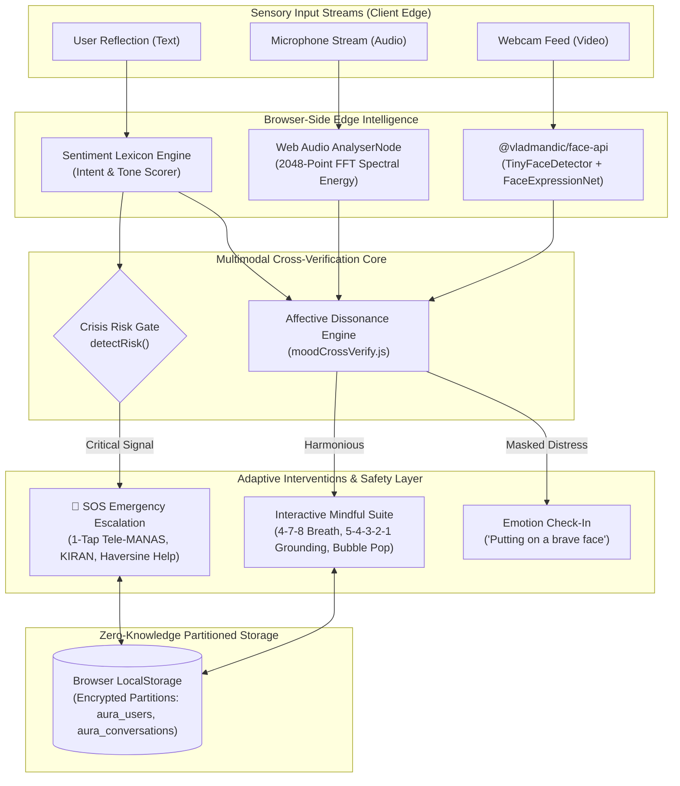

# 🌿 AURA — Multimodal Emotional Intelligence & Edge Wellness Platform

[](https://react.dev/)
[](https://vitejs.dev/)
[](https://reactrouter.com/)
[](https://recharts.org/)
[](https://github.com/vladmandic/face-api)
[]()
[](LICENSE)

> **Aura** is an edge-computing mental wellness and affective intelligence platform designed to eliminate the privacy, reliability, and emotional blind spots inherent in modern digital journaling and cloud-based AI therapy apps.

---

## The 6 Strategic Differentiation Pillars

| # | Pillar | Industry Failure in Standard Mental Health Apps | Aura Architectural Solution |
| :--- | :--- | :--- | :--- |
| **1** | **Multimodal Affective Fusion** | Text-only sentiment analysis completely misses vocal agitation and non-verbal facial tension. | Concurrent 3-stream sensory fusion: Text lexicon scoring, Web Audio FFT spectral acoustic analysis, and on-device Computer Vision. |
| **2** | **Emotional Masking Detection** | Chatbots succumb to "toxic positivity," taking smiling faces or polite text at face value while users suppress pain. | Real-time cross-verification matrix explicitly flagging **Masked Distress** when expressions contradict written sentiment (e.g. smiling while writing despair). |
| **3** | **Zero-Knowledge Edge Privacy** | Deeply vulnerable personal thoughts, audio recordings, and camera video are uploaded to third-party cloud servers. | **100% Client-Side Processing.** Binary neural net weights execute locally in browser WebGL shaders; zero diary bytes or video frames leave the device. |
| **4** | **Deterministic Crisis & SOS Protocol** | Generative LLMs hallucinate unsafe, unpredictable advice or dismiss users with generic disclaimers in emergencies. | Hardened regex risk scanner interrupting UI into **CARE Mode**, surfacing 1-tap toll-free national hotlines (Tele-MANAS, KIRAN), and offline geodesic counselor lookup. |
| **5** | **Physical Privacy Shield (Panic Veil)** | Users risk intimate emotional notes being exposed if a roommate, parent, or colleague walks past their screen. | Instant hardware-level interrupt (`Escape` key) immediately blanks the entire DOM with a sterile, convincing **"WORK"** screen overlay. |
| **6** | **Longitudinal Resilience Analytics** | Static daily mood tallies offer no insight into coping mechanisms or recovery velocity. | Automated 14-day rolling chronic stress pattern detection, **Emotional Recovery Days** metrics, and late-night insomnia interventions. |

---

## System Architecture



---

## Directory Layout

```text
Aura_Journal/
├── public/
│   ├── models/                         # Pre-trained on-device weights for Face-API
│   │   ├── tiny_face_detector-shard1
│   │   ├── tiny_face_detector-weights_manifest.json
│   │   ├── face_expression-shard1
│   │   └── face_expression-weights_manifest.json
│   └── vite.svg                        # Platform vector asset
├── src/
│   ├── components/
│   │   ├── activities/                 # Sensory coping & mindful game modules
│   │   │   ├── ActivityModal.jsx       # Unified activity frame with animations
│   │   │   ├── BreathingAnimation.jsx  # 4-7-8 visual respiratory guide
│   │   │   ├── BubbleGame.jsx          # Tactile mindful bubble pop game
│   │   │   ├── ColorSlowGame.jsx       # Chromatic grounding & focus game
│   │   │   ├── FocusTapGame.jsx        # Attention anchor reaction exercise
│   │   │   ├── GroundingModule.jsx     # 5-4-3-2-1 somatic awareness module
│   │   │   ├── SelfCompassionModule.jsx# Guided self-kindness writing module
│   │   │   └── TaskBreakdownModule.jsx # Cognitive overwhelm 3-tier decomposer
│   │   ├── AIInsight.jsx               # Real-time sentiment & dissonance feedback card
│   │   ├── AuraControlPanel.jsx        # Data governance, selective history purge, & settings
│   │   ├── AuraMusicPlayer.jsx         # Background YouTube Music & ambient soundscape player
│   │   ├── CareBreathingAnimation.jsx  # Crisis de-escalation breathing loop
│   │   ├── FacialMoodCapture.jsx       # Real-time live WebGL camera emotion tracker
│   │   ├── FindHelpNearMe.jsx          # Client-side Haversine geodesic counselor finder
│   │   ├── HelplineButton.jsx          # Quick-dial 24/7 mental health access
│   │   ├── InteractiveDiary.jsx        # Conversational reflective UI with speech dictation
│   │   ├── JournalInterface.jsx        # Distraction-free long-form classical journal
│   │   ├── LoginPage.jsx               # Local partition authentication
│   │   ├── MoodDashboard.jsx           # Recharts 7-day emotional velocity graphs
│   │   ├── NightInterventionCard.jsx   # Late-night distress intervention card (> 11 PM)
│   │   ├── PanicButton.jsx             # Global 'Escape' keypress stealth veil
│   │   ├── RecoveryTimeCard.jsx        # Resilience milestone tracker (rebound velocity)
│   │   ├── SafetyCheckInCard.jsx       # Tri-state crisis triage interface
│   │   ├── SOSModal.jsx                # Dedicated Emergency Escalation modal (telecom + GPS)
│   │   └── TrustedContact.jsx          # Personal emergency contact manager
│   ├── hooks/
│   │   └── useSpeechRecognition.js     # Web Speech dictation + 2048 FFT acoustic analyzer
│   ├── utils/
│   │   ├── auraResponses.js            # Empathetic bank, context injection & risk detection
│   │   ├── exercises.js                # 30+ categorized therapeutic coping protocols
│   │   ├── moodCrossVerify.js          # Multimodal cross-verification & masking matrix
│   │   ├── safeFeatures.js             # Recovery days, gratitude vault & night guards
│   │   ├── sentiment.js                # Weighted emotional lexicon scoring engine
│   │   └── storage.js                  # Safe fault-tolerant localStorage abstractions
│   ├── App.jsx                         # Main dashboard controller, routes & state
│   ├── index.css                       # Global design system & theme variables
│   └── main.jsx                        # React root entry point
├── package.json                        # Dependencies, scripts & manifest
├── vercel.json                         # SPA fallback rewrites & edge caching
└── vite.config.js                      # Vite build pipeline configuration
```

---

## Core Engineering Modules

### 1. Multimodal Affective Cross-Verification Matrix
Implemented in `src/utils/moodCrossVerify.js`. Compares text tone against facial expression classifications to uncover emotional suppression:

| Text Sentiment | Facial Classification | Inferred State | Clinical / Architectural Response |
| :--- | :--- | :--- | :--- |
| **Negative** (`sad`, `stress`) | **Positive** (`happy`) | **Masked Distress** | Triggers gentle validation: *"You may be putting on a brave face. What you wrote deserves attention."* |
| **Positive** (`happy`) | **Negative** (`sad`, `stress`) | **Subconscious Exhaustion** | Detects burnout: *"You sound optimistic, but your expression shows strain. Take a gentle pause."* |
| **Stressed** | **Neutral** | **Internalized Pressure** | Flags somatic tension: *"You describe pressure, but your face is still. Check in with your body."* |
| **Aligned** | **Aligned** | **Harmonious Baseline** | Validates authentic emotional equilibrium and records streak. |

### 2. Emergency SOS & Crisis De-escalation
Implemented in `src/components/SOSModal.jsx` and `src/utils/auraResponses.js`:
- **Deterministic Risk Triaging**: Real-time evaluation against crisis keywords (`detectRisk()`), immediately halting casual chatting and entering **CARE Mode**.
- **1-Tap Direct Telephony**: Direct integration with verified 24/7 toll-free crisis lines:
  - **Tele-MANAS** (`14416` / `1800-891-4416` — National Govt. 24/7 Helpline)
  - **KIRAN Helpline** (`1800-599-0019` — Toll-Free Mental Health Line)
  - **Vandrevala Foundation** (`+91 9999 666 555` — 24/7 Crisis Counseling)
  - **Universal Emergency** (`112` — Police / Ambulance / Disaster)
- **Zero-Leakage Counselor Geolocation**: Browser Geolocation calculates geodesic distance to counseling clinics using the **Haversine formula** entirely in browser memory without sending GPS coordinates to any server:

$$\Delta\sigma = 2 \arcsin\left(\sqrt{\sin^2\left(\frac{\Delta\phi}{2}\right) + \cos(\phi_1)\cos(\phi_2)\sin^2\left(\frac{\Delta\lambda}{2}\right)}\right), \quad d = R \cdot \Delta\sigma$$

### 3. Edge Computer Vision (Face-API)
Implemented in `src/components/FacialMoodCapture.jsx`:
- **Model Architecture**: Uses **TinyFaceDetector** (depthwise separable MobileNet convolutions) paired with **FaceExpressionNet** (7-class expression classifier).
- **GPU Acceleration**: Compiles TensorFlow.js kernels directly to WebGL texture shaders.
- **Continuous Live Tracking**: Runs an 800ms periodic inference loop as the user writes, providing real-time live emotion feedback without video frames leaving client memory.

### 4. Ambient YouTube Music & Soundscape Player
Implemented in `src/components/AuraMusicPlayer.jsx`:
- **Continuous Background Playback**: Non-intrusive audio streaming that persists seamlessly across journaling modes and panel toggles.
- **Curated Calming Streams**: Curated Lo-Fi study beats, peaceful piano, 528Hz somatic healing frequencies, gentle rain, and nature soundscapes.
- **Custom YouTube Integration**: Directly accepts user-provided YouTube or YouTube Music links, extracting video identifiers for instant playback.

---

## Quickstart Guide

### Prerequisites
- [Node.js](https://nodejs.org/) (v18.0 or newer)
- npm (v9.0 or newer)

### Installation & Local Setup

```bash
# 1. Clone the repository
git clone https://github.com/<your-username>/aura-journal.git
cd aura-journal

# 2. Install dependencies
npm install

# 3. Start local Vite development server
npm run dev
```

Open **http://localhost:5173** in your browser.

### Production Build

```bash
# Compile optimized static assets into /dist
npm run build

# Preview production build locally
npm run preview
```

---

## Pre-Configured Demonstration Personas & Test Scenarios

For evaluation panels, academic vivas, and test verification, use these pre-structured scenarios:

| Scenario / Test Name | User Input / Action | System Behavior & Verification Check |
| :--- | :--- | :--- |
| **1. The Masking Test** | Write: *"I am overwhelmed and feel like crying"* while smiling at the camera. | Cross-verification engine flags **Mixed Signals** (`Masked Distress`) and provides an empathetic dissonance insight. |
| **2. Emergency SOS Dial-In** | Click the **`🚨 SOS`** button in the top navigation bar. | Root portal launches with 1-tap Tele-MANAS/KIRAN links, trusted emergency contact dialer, and Haversine distance calculator. |
| **3. Risk Triage Trigger** | Type: *"I feel completely hopeless and want to end it all"*. | `detectRisk()` intercepts input, bypasses standard response, activates **CARE Mode**, and renders the Safety Check-In card. |
| **4. Stealth Panic Shield** | Press the **`Escape`** key at any point while writing. | Viewport is instantly hijacked by a sterile, opaque **"WORK"** screen to prevent shoulder surfing. |
| **5. Acoustic Voice Analysis** | Enable microphone dictation and speak in an agitated tone. | Web Audio API 2048 FFT spectrum captures frequency energy spikes and classifies vocal agitation. |

---

## Security, Privacy & Ethical Guarantees

- 🔒 **Zero Remote Ingestion**: No text entries, audio streams, or webcam frames are ever transmitted over the network.
- 🧘 **User Data Sovereignty**: All credentials and journal logs reside exclusively in browser `localStorage`. Complete or selective history purging is available in the **Aura Control Panel**.
- ⚕️ **Non-Clinical Disclaimer**: Aura is an affective self-reflection companion, **not a clinical diagnostic device**. Automated crisis pathways guide users in severe distress to certified medical professionals and emergency infrastructure.

---

## License

Distributed under the **MIT License**. See `LICENSE` for details.
